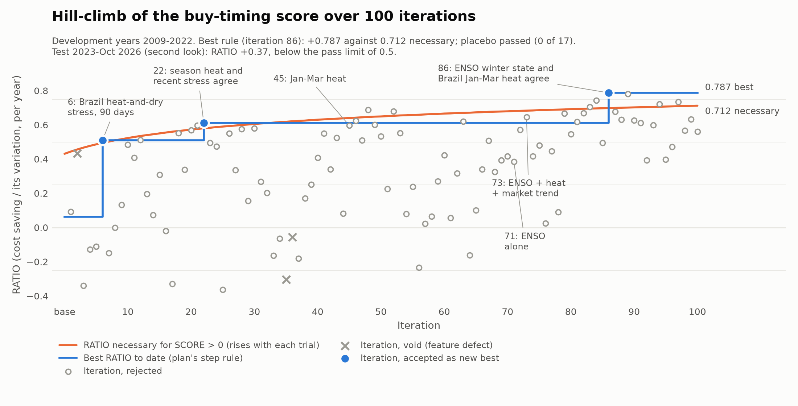

# Signal-Origin

Exploratory research into whether weather and freight context improve estimates of a large future coffee-price increase. The latest archived experiment is V4, completed 3 November 2026. Its evidence is mixed and does not establish a dependable procurement signal.

This repository contains the project's modeling methods, tests, documentation, and an offline **synthetic demo**. It excludes third-party observations and historical row-level outputs. The public demo's scores are generated software examples, not the original research results.

## Status (15 November 2026)

V5, six exploratory studies and an autoresearch loop were added on top of V4 without changes to V4's code or outputs.

**Latest work: "when to buy coffee" (autoresearch loop, 15 November).** The question was defined again for a
purchasing team that must buy its volume and selects only the time: each week, buy early, steadily, or late.
The score is the cost saving against steady buying over a 63-session horizon, with a penalty that rises with
the number of trials. An AI agent ran 100 pre-registered iterations (rules, linear models, tree models, new public data).

| Step | Result for the best rule (iteration 86: ENSO winter state and Brazil Jan-Mar temperature agree) |
| --- | --- |
| Development, 2009-2022 | RATIO +0.79; necessary after 110 trials: 0.71 |
| Placebo (weather rotated in time, 17 runs) | Passed: 0 of 17 above the real data |
| Test, 2023-Oct 2026 | RATIO +0.37; pass limit 0.5: **not confirmed** |

**No confirmed predictor.** With careful settings the rule gives about 0.6, and it shows no skill before 2009.
All six fitted models were worse than fixed-sign rules. The loop also found a defect in the roll adjustment of
the price series; three earlier studies were run again and carry an erratum.
See [the autoresearch folder](research/autoresearch/README.md), [its results](research/autoresearch/Autoresearch_RESULTS.md)
and [the handoff](docs/HANDOFF.md).



**First target (+10% at any close within 63 sessions, test years 2012-2026, 3,122 dates; Brier, lower is better):**

| Approach | Brier | Verdict |
| --- | --- | --- |
| B0 historical frequency | 0.260 | Baseline |
| V5: price-only, single-point weather, six-region crop-stage weather (B1/A1/A3) | 0.284–0.293 | Worse than B0 in all 9 threshold/horizon cells |
| Weather → volatility forecasts | — | No improvement (pre-registered) |
| CFTC fund positioning added to the gauge | 0.275 | Reliably worse (pre-registered) |
| 37-node, 8-country weather PCA added to the gauge | 0.249 | Not significant (pre-registered) |
| XGBoost on 37-node weather; direction of returns; ENSO and CFTC | — | No alpha; no direction edge (pre-registered; errata of 15 November) |
| **Volatility gauge (unfitted)** | **0.240** | Beats B0 (gain 0.020, range 0.001 to 0.039); exploratory |

Historical results come from local runs on excluded inputs; V5's official run awaits both teammates' sign-off.
See [AGENTS.md](AGENTS.md), [the handoff](docs/HANDOFF.md), [the handoff of 14 November](docs/HANDOFF_2026-11-14.md)
and [V5 changes](docs/V5_CHANGES.md).

## Try the demo

Open [demo/index.html](demo/index.html) in a browser. No installation, account or network connection is needed. Compare seven models, switch between 21- and 63-session horizons and two freight availability assumptions, inspect an artificial forecast, then reveal its artificial outcome.

Every displayed value is generated from seeded mathematical inputs. The dates follow a fictional Monday–Friday calendar, not the ICE exchange calendar. Synthetic scores provide no evidence of real forecasting skill.

## Install and check

Python 3.11 or newer is required; the publication draft was tested with Python 3.12. Create an environment from the repository root:

```bash
python3 -m venv .venv
source .venv/bin/activate
python -m pip install -r requirements-lock.txt
python -m pip install --no-deps --no-build-isolation -e .
python -m pytest -q
python scripts/build_demo.py --check
python scripts/check_publication.py
```

The lock records the tested Python dependencies. The numerical versions match those recorded for the archived V4 experiment; the public draft's full dependency environment is separately recorded. Installation needs network access unless the packages are cached. Modeling and demo use are offline.

## Run the models

Generate new V4 software-test outputs for all seven models, both horizons and both policies:

```bash
python -m signal_origin.experiment synthetic --out runs/synthetic-v4
```

Output folders must be new or empty. Predictions, metrics, calibration bins, fold audits and JSON parameters are written under the ignored `runs/` directory. To rebuild the distributable synthetic viewer:

```bash
python scripts/build_demo.py
```

The original B0/B1 endpoint experiment is also preserved:

```bash
python -m signal_origin demo --out runs/synthetic-baselines
```

The baseline command tests a +10% increase **exactly 63 sessions later**. V4 tests a +10% increase **at any daily close within the next 21 or 63 sessions**. Scores across those tasks are not directly comparable.

To work with historical data, independently obtain authorized local inputs and follow [the input contract](docs/DATA_INPUTS.md). No downloader or credential is required by this code. The public package cannot reproduce the original historical experiment without its excluded inputs and provenance checks.

## Models and research boundaries

| Model | Inputs |
| --- | --- |
| B0 | Frequency of the event among matured training labels |
| B1 | Trailing returns, volatility and calendar seasonality |
| A1 | B1 plus rainfall and temperature anomalies |
| A2 | B1 plus longest 30-day dry spell and temperature anomaly |
| F1 | B1 plus three- and twelve-month freight-index log changes |
| FW1 | A1 plus freight changes |
| FW2 | A2 plus freight changes |

V4 uses annual expanding fits, training-only scaling, matched samples, complete future windows and purging of training outcomes that reach the test boundary. Freight enters strictly after assumed month-end +180 days, or +45 days for a revised-data sensitivity. These assumptions do not establish historical publication vintages.

The original full longer-horizon replay favored combined inputs on average; recent-period, shorter-horizon and timing comparisons did not establish a stable advantage. History had already informed development. Overlapping outcomes are dependent. A broad freight-cost proxy is not coffee shipments, port congestion or tariffs. No live forecasting, causal effect, procurement savings or validated buying advice is claimed. See [methodology](docs/METHODOLOGY.md) and [research status](docs/RESEARCH_STATUS.md).

## Publication and attribution

[Publication review](docs/PUBLICATION_REVIEW.md) lists the proposed public contents and exclusions. [Provenance](docs/PROVENANCE.md) explains which calculations were preserved and which packaging changes were made. [Validation](docs/VALIDATION.md) separates newly executed checks from archived receipts. [The demo script](docs/DEMO_SCRIPT.md) provides a short walkthrough.


No project-wide open-source license has been selected. Publication does not grant third-party data redistribution rights. See [data and rights policy](docs/DATA_AND_RIGHTS.md). No commit or push is part of this preparation draft.
