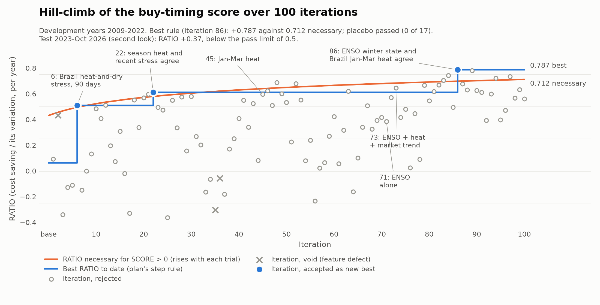

# Autoresearch loop: when to buy coffee. Results after 100 iterations (15 Nov 2026)

Plan: `Autoresearch_PLAN.md` (sha256 a145c605...eff9). Deviations and extension: `Autoresearch_PLAN_ADDENDUM_1.md`
(roll repair, void rule; Celine accepted the repair on 15 Nov) and `Autoresearch_PLAN_ADDENDUM_2.md` (iterations 31-100,
data rule, second test look). Agent: Claude. All runs on the Mac mini. Code, trial log, journal and aggregate results:
`research/autoresearch/`. Reflection after each iteration: `research/autoresearch/JOURNAL.md`.

## Verdict: one rule passed development; the test period did not confirm it
| Step | Iterations 1-30 (c22) | Iterations 31-100 (c86) |
|---|---|---|
| Best rule by the plan | Season heat and 90-day stress agree | ENSO winter state and Brazil Jan-Mar heat agree |
| RATIO on 2009-2022 | +0.612 (necessary 0.605 at N = 40) | +0.787, range +0.38 to +1.23 (necessary 0.712 at N = 110) |
| Constraints C1-C5, C7 | Satisfied | Satisfied: 11 of 14 years positive, halves +0.79 / +0.78 |
| C6 placebo (17 rotated runs) | FAILED (1 of 17 above) | PASSED (0 of 17 above; highest +0.613; p about 0.06) |
| Test 2023-Oct 2026 | First look: +0.040, FAIL | Second look: +0.374 (range -0.60 to +1.43), 2 of 4 years positive, FAIL (limit 0.5) |
| Statement by the plan | No predictor found | Not confirmed |

The rule of iteration 86, in words: "In mid February, look at two values. (1) The Nino 3.4 index of January.
(2) The mean temperature of January-March to date in the Brazilian coffee regions, against the same period of the last
5 years. Both warm: buy early for the next 12 months. Both cool: buy late. If they disagree: buy steadily. Update (2)
until the end of March." It makes about one call a year. On 2009-2022 it saved 2.3% of the yearly purchase cost.

Why I do not call it a predictor:
- It is the top of its own design. The same rule with other reasonable settings gives 0.50-0.79: ERA5 temperature
  +0.50, both weather products +0.60, 10-year normal +0.63, window Dec-Feb +0.63, maximum temperature +0.68, fresh
  weather +0.71, seasonal ENSO +0.74, Minas only +0.78. With careful settings (iterations 93, 99) it gives +0.60-0.63,
  which is below the necessary 0.712 and below the highest placebo run (+0.613).
- It makes about 9 active yearly calls in 14 years. A score from 9 calls has a very wide range.
- Before 2009 it had no skill: in 2001-2008 it agreed with the label on 51% of its active days (71% in 2009-2022).
  The Brazil heat sign alone agreed on 42% of days before 2009; only the ENSO sign was stable (58% / 64% / 60%).
- The test period holds 4 calls (one wrong, two correct, one wrong). Its RATIO of +0.37 does not prove and does not
  reject the rule. It was the second look at these years.

## Hill-climb

## What the 100 iterations show
| Block | Runs | Best RATIO | Verdict |
|---|---|---|---|
| ENSO winter state + Brazil Jan-Mar heat (two-state rule) | 83-99 | +0.79 (careful settings +0.60) | Lead; not confirmed |
| Brazil Jan-Mar heat alone | 45, 48-53, 77 | +0.69 (ERA5 +0.45) | Skill on 2009-2022 only; opposite sign before 2009 |
| ENSO winter state alone (El Nino: buy early), held for a year | 71, 74 | +0.42 | Weak, but the only signal with the same sign in 2001-2022 |
| Votes of ENSO, Brazil heat and slow market trend | 72, 73, 79-82, 100 | +0.67 | Most even over time (halves +0.63 / +0.66); below the bar |
| Slow trend of five markets (sugar, Brazil equities, copper, dollar, coffee) | 27, 42, 66 | +0.34 | Small and stable; 3-month horizon has no value |
| Other weather: 90-day stress, season heat, soil moisture, other origins, Vietnam, Colombia | 5-12, 18-24, 55, 67 | +0.61 | Mostly the same ENSO-linked warmth |
| Water stress: rain, soil moisture, water balance (rain minus ET0) | 5, 11, 19, 78 | +0.41 | No stable skill (water balance +0.09): the signal is temperature, not water |
| Price factors: trend, carry, value, price in reais | 1, 3, 4, 56 | +0.09 | No skill; value rules have the opposite sign |
| Positioning (CFTC), export flow, stocks, calendar, currencies, rates, fear index | 7, 13, 14, 29, 33, 37, 38, 54, 59, 61 | +0.27 | No stable skill |
| Climate indices as monthly states (ENSO, Indian Ocean Dipole) | 8, 64 | 0.00 | No skill in this form |
| Fitted models: logistic (3), random forest, LightGBM, decision tree | 15-17, 57, 58, 76 | +0.31 | All worse than rules with a fixed sign |

Three falsification tests (34, 68, 92) support that Brazil adds information to the ENSO state on 2009-2022: heat of
regions without a crop reason gave -0.07, +0.33 alone, and nothing on top of ENSO (+0.39 against +0.79 with Brazil).

## What changed in each iteration
RATIO is for 2009-2022 (eval revision 1). "Step rule": accepted only if the paired bootstrap shows a gain over the
current best. "Partly" = RATIO at or above 0.45 with all constraints satisfied, but no shown gain over the current best.

| It. | Block | What changed | RATIO | Halves | Years + | Step rule | Worked? |
|---|---|---|---|---|---|---|---|
| 1 | Price | Trend rule: sign of the 12-month return | +0.093 | +0.50 / -0.34 | 7/14 | rejected | No |
| 2 | Price | 'Carry' from the marked roll days (wrong day; VOID) | +0.434 | +0.76 / +0.09 | 6/14 | VOID | No (void) |
| 3 | Price | Carry rule from the correct contract-gap day | -0.340 | -0.43 / -0.24 | 5/14 | rejected | No |
| 4 | Price | Value rule: price against its 5-year mean | -0.129 | -0.13 / -0.13 | 7/14 | rejected | No |
| 5 | Weather | Brazil rain deficit, 90 days (raw level) | -0.110 | -0.24 / +0.02 | 7/14 | rejected | No |
| 6 | Weather | Brazil heat-and-dry stress, 90 days, drift removed | +0.510 | +0.26 / +0.77 | 9/14 | ACCEPTED (new best) | Yes |
| 7 | Positioning | Speculator positions at extremes (CFTC) | -0.149 | -0.48 / +0.24 | 7/14 | rejected | No |
| 8 | Climate index | ENSO state rule (La Nina / El Nino) | -0.001 | +0.20 / -0.20 | 7/14 | rejected | No |
| 9 | Weather | Stress of the other origins | +0.133 | -0.26 / +0.54 | 9/14 | rejected | No |
| 10 | Weather | c06 + frost days | +0.484 | +0.11 / +0.88 | 9/14 | rejected | Partly |
| 11 | Weather (new source 1) | Brazil root-zone soil moisture | +0.408 | -0.02 / +0.86 | 9/14 | rejected | No |
| 12 | Weather | Stress and soil moisture must agree | +0.512 | +0.14 / +0.91 | 8/14 | rejected | Partly |
| 13 | Other market (new source 2) | Dollar index trend | +0.197 | +0.00 / +0.40 | 7/14 | rejected | No |
| 14 | Other market | USD/BRL trend | +0.073 | +0.25 / -0.11 | 7/14 | rejected | No |
| 15 | Model | Logistic regression on 4 signals | +0.308 | +0.31 / +0.31 | 9/14 | rejected | No |
| 16 | Model | Random forest on 16 features | -0.019 | -0.32 / +0.30 | 8/14 | rejected | No |
| 17 | Model | LightGBM on 15 features | -0.329 | -0.48 / -0.16 | 4/14 | rejected | No |
| 18 | Weather | Stress of the crop season to date (Oct-Apr) | +0.553 | +0.21 / +0.92 | 11/14 | rejected | Partly |
| 19 | Weather | Season rain deficit only | +0.339 | -0.23 / +0.94 | 9/14 | rejected | No |
| 20 | Weather | Season heat only | +0.569 | +0.17 / +0.99 | 11/14 | rejected | Partly |
| 21 | Weather | Season maximum temperature | +0.596 | +0.24 / +0.97 | 11/14 | rejected | Partly |
| 22 | Weather | Season heat and 90-day stress must agree | +0.612 | +0.28 / +0.96 | 11/14 | ACCEPTED (new best) | Yes |
| 23 | Robustness | c22 with weather 10 days old | +0.495 | +0.24 / +0.77 | 11/14 | rejected | Partly |
| 24 | Robustness | c22 with a 10-year normal | +0.473 | +0.28 / +0.69 | 9/14 | rejected | Partly |
| 25 | Other market (new source 3) | Arabica-robusta price spread | -0.363 | -0.08 / -0.67 | 5/14 | rejected | No |
| 26 | Weather | c22 + memory of the previous season | +0.550 | +0.32 / +0.79 | 8/14 | rejected | Partly |
| 27 | Other market (new source 4) | Sugar trend | +0.336 | +0.34 / +0.33 | 10/14 | rejected | No |
| 28 | Combination | Vote: weather rule (c22) + sugar trend | +0.576 | +0.47 / +0.67 | 12/14 | rejected | Partly |
| 29 | Supply (new source 5) | USDA world stocks-to-use | +0.155 | +0.23 / +0.09 | 5/14 | rejected | No |
| 30 | Combination | Majority of season heat, 90-day stress, sugar | +0.579 | +0.30 / +0.88 | 11/14 | rejected | Partly |
| 31 | Other markets | Breadth of 5 farm commodities (new data: Yahoo) | +0.269 | +0.09 / +0.46 | 10/14 | rejected | No |
| 32 | Other markets | Brazil equity fund trend | +0.202 | +0.35 / +0.05 | 9/14 | rejected | No |
| 33 | Calendar | Frost-risk calendar rule (no data) | -0.163 | -0.21 / -0.11 | 7/14 | rejected | No |
| 34 | Falsification | Season heat of the other origins (Oct-Apr) | -0.065 | +0.10 / -0.24 | 6/14 | rejected | No |
| 35 | Supply flow (new source) | Brazil export volume (incomplete file; VOID) | -0.303 | -0.34 / -0.26 | 6/14 | VOID | No (void) |
| 36 | Supply flow | Brazil export volume, 2nd try (file still incomplete; VOID) | -0.055 | -0.07 / -0.03 | 6/14 | VOID | No (void) |
| 37 | Supply flow | Brazil export volume, complete file | -0.180 | -0.07 / -0.29 | 5/14 | rejected | No |
| 38 | Positioning | Hedging pressure of producers (CFTC) | +0.171 | +0.69 / -0.44 | 6/14 | rejected | No |
| 39 | Other markets | World growth vote: S&P 500, copper, crude | +0.251 | -0.02 / +0.54 | 9/14 | rejected | No |
| 40 | Weather | It. 22 with price confirmation | +0.408 | +0.58 / +0.26 | 9/14 | rejected | No |
| 41 | Weather | Season heat, large anomalies only | +0.551 | +0.29 / +0.81 | 11/14 | rejected | Partly |
| 42 | Other markets | Five-market slow trend composite | +0.340 | +0.41 / +0.27 | 10/14 | rejected | No |
| 43 | Combination | Weather rule (22) + five-market composite | +0.525 | +0.50 / +0.55 | 11/14 | rejected | Partly |
| 44 | Weather | Flowering heat only (Sep-Nov) | +0.082 | -0.58 / +0.78 | 9/14 | rejected | No |
| 45 | Weather | Grain-fill heat only (Jan-Mar) | +0.596 | +0.51 / +0.68 | 10/14 | rejected | Partly |
| 46 | Weather | Grain-fill heat and 90-day stress agree | +0.624 | +0.44 / +0.82 | 10/14 | rejected | Partly |
| 47 | Combination | Majority: fill heat, stress, market composite | +0.509 | +0.32 / +0.71 | 11/14 | rejected | Partly |
| 48 | Robustness | It. 45 with weather 10 days old | +0.687 | +0.52 / +0.86 | 10/14 | rejected | Partly |
| 49 | Robustness | It. 45 with a 10-year normal | +0.601 | +0.57 / +0.63 | 9/14 | rejected | Partly |
| 50 | Robustness | It. 45 with window Dec-Feb | +0.533 | +0.32 / +0.76 | 9/14 | rejected | Partly |
| 51 | Robustness | It. 45 with window Feb-Apr | +0.225 | +0.07 / +0.39 | 9/14 | rejected | No |
| 52 | Robustness | It. 45 with mean temperature | +0.680 | +0.62 / +0.74 | 11/14 | rejected | Partly |
| 53 | Robustness | It. 45 with Minas Gerais only | +0.553 | +0.50 / +0.61 | 9/14 | rejected | Partly |
| 54 | Other markets | US 10-year yield change | +0.079 | -0.22 / +0.40 | 9/14 | rejected | No |
| 55 | Weather (new data) | Vietnam dry-season heat (robusta supply) | +0.239 | +0.27 / +0.21 | 9/14 | rejected | No |
| 56 | Price | Coffee price in reais against its 1-year mean | -0.233 | -0.42 / -0.04 | 5/14 | rejected | No |
| 57 | Model | Logistic regression on the 4 best features | +0.023 | +0.04 / +0.00 | 9/14 | rejected | No |
| 58 | Model | Logistic regression with time-decay weights | +0.064 | -0.13 / +0.27 | 8/14 | rejected | No |
| 59 | Other markets | Market fear: VIX against its 1-year mean | +0.270 | -0.30 / +0.87 | 9/14 | rejected | No |
| 60 | Combination | Market composite and Vietnam heat agree | +0.422 | +0.53 / +0.32 | 9/14 | rejected | No |
| 61 | Other markets | Colombian peso trend | +0.056 | -0.03 / +0.15 | 9/14 | rejected | No |
| 62 | Other markets | Robusta price trend (World Bank) | +0.317 | +0.60 / +0.02 | 9/14 | rejected | No |
| 63 | Exposure | It. 22 with a volatility switch | +0.620 | +0.29 / +0.93 | 11/14 | rejected | Partly |
| 64 | Climate index (new source) | Indian Ocean Dipole (NOAA) | -0.162 | -0.01 / -0.27 | 6/14 | rejected | No |
| 65 | Robustness | Market composite, 63-session horizon | +0.100 | +0.15 / +0.04 | 10/14 | rejected | No |
| 66 | Robustness | Market composite, 252-session horizon | +0.341 | +0.39 / +0.29 | 10/14 | rejected | No |
| 67 | Weather | Colombia flowering heat (Jan-Mar) | +0.507 | +0.66 / +0.35 | 10/14 | rejected | Partly |
| 68 | Falsification | Central America heat in Jan-Mar (no crop meaning) | +0.326 | +0.48 / +0.17 | 7/14 | rejected | No |
| 69 | Weather | Brazil-specific heat (Brazil minus other regions) | +0.393 | +0.27 / +0.52 | 10/14 | rejected | No |
| 70 | Weather | Common Jan-Mar warmth outside Brazil | +0.416 | +0.67 / +0.15 | 8/14 | rejected | No |
| 71 | Climate index | ENSO state of January, held for a year | +0.385 | +0.41 / +0.36 | 9/14 | rejected | No |
| 72 | Combination | Majority: ENSO, Brazil-specific heat, market composite | +0.572 | +0.59 / +0.55 | 11/14 | rejected | Partly |
| 73 | Combination | Majority: ENSO, Brazil fill heat, market composite | +0.646 | +0.63 / +0.66 | 11/14 | rejected | Partly |
| 74 | Climate index | ENSO rule for real events only | +0.417 | +0.61 / +0.25 | 9/14 | rejected | No |
| 75 | Combination | ENSO state and market composite agree | +0.481 | +0.54 / +0.41 | 10/14 | rejected | Partly |
| 76 | Model | Depth-2 decision tree on 3 inputs | +0.025 | +0.21 / -0.17 | 7/14 | rejected | No |
| 77 | Robustness (new source) | Brazil fill heat from ERA5 | +0.447 | +0.66 / +0.22 | 11/14 | rejected | No |
| 78 | Weather | Brazil water balance, rain minus ET0 (ERA5) | +0.091 | +0.17 / +0.00 | 7/14 | rejected | No |
| 79 | Robustness | It. 73 with weather 10 days old | +0.666 | +0.67 / +0.67 | 11/14 | rejected | Partly |
| 80 | Robustness | It. 73 with ERA5 heat | +0.545 | +0.70 / +0.38 | 10/14 | rejected | Partly |
| 81 | Robustness | It. 73 with 252-session trends | +0.618 | +0.35 / +0.90 | 11/14 | rejected | Partly |
| 82 | Robustness | It. 73 with Dec-Feb ENSO mean | +0.669 | +0.72 / +0.62 | 12/14 | rejected | Partly |
| 83 | Combination | ENSO state and Brazil fill heat agree | +0.705 | +0.72 / +0.69 | 10/14 | rejected | Partly |
| 84 | Robustness | It. 83 with Dec-Feb ENSO mean | +0.743 | +0.82 / +0.67 | 10/14 | rejected | Partly |
| 85 | Robustness | It. 83 with ERA5 heat | +0.495 | +0.69 / +0.32 | 9/14 | rejected | Partly |
| 86 | Robustness | It. 83 with weather 10 days old | +0.787 | +0.79 / +0.78 | 11/14 | ACCEPTED (new best) | Yes |
| 87 | Robustness | It. 86 with maximum temperature | +0.677 | +0.59 / +0.77 | 10/14 | rejected | Partly |
| 88 | Robustness | It. 86 with a 10-year normal | +0.631 | +0.75 / +0.50 | 10/14 | rejected | Partly |
| 89 | Robustness | It. 86 with Minas Gerais only | +0.780 | +0.77 / +0.79 | 11/14 | rejected | Partly |
| 90 | Robustness | It. 86 with window Dec-Feb | +0.626 | +0.53 / +0.72 | 9/14 | rejected | Partly |
| 91 | Combination | ENSO state and Brazil-specific heat agree | +0.612 | +0.52 / +0.73 | 9/14 | rejected | Partly |
| 92 | Falsification | ENSO state with Central America heat | +0.394 | +0.55 / +0.25 | 10/14 | rejected | No |
| 93 | Robustness | It. 86 with both weather products (POWER + ERA5) | +0.599 | +0.77 / +0.46 | 10/14 | rejected | Partly |
| 94 | Combination | ENSO, Brazil heat and market composite all agree | +0.722 | +0.81 / +0.65 | 11/14 | rejected | Partly |
| 95 | Combination | ENSO state with Vietnam heat | +0.397 | +0.46 / +0.33 | 9/14 | rejected | No |
| 96 | Combination | ENSO state with Colombia heat | +0.471 | +0.60 / +0.35 | 10/14 | rejected | Partly |
| 97 | Robustness | It. 86 with ENSO events only | +0.735 | +0.79 / +0.68 | 11/14 | rejected | Partly |
| 98 | Robustness | It. 86 with ENSO updated in mid year | +0.567 | +0.52 / +0.61 | 10/14 | rejected | Partly |
| 99 | Combination | Careful design: Dec-Feb ENSO + two-product Brazil heat | +0.633 | +0.86 / +0.45 | 10/14 | rejected | Partly |
| 100 | Combination | Careful design + market composite (majority) | +0.561 | +0.74 / +0.37 | 11/14 | rejected | Partly |

Baselines: steady 0.000; always-early -0.062; always-late +0.062; 63-session momentum +0.028; market-only logistic
-0.153; market-only + Nino 3.4 -0.007.

## Defect found in the price series (accepted repair)
The 134 "suspected roll" days mark the last day of the old contract; the gap between contracts is in the next session
(mean +1.1%). The earlier roll adjustment removed the wrong day. Eval revision 1 sets both days to zero. The earlier
studies were run again with the repair: see the erratum at the end of `research/exploratory/direction_study/RESULTS.md`,
`RESULTS2_ENSO_CFTC.md` (same folder) and `research/exploratory/xgb_multi_origin/RESULTS.md`.

## Deviations and errors (all in the trial log)
1. Roll repair after iteration 2 without a stop (addendum 1). Celine accepted it later.
2. Void rule (addendum 1), used three times: iteration 2 (feature was not carry), iterations 35 and 36 (export file
   incomplete: my error; the code now stops when a month is missing). Void runs count in N.
3. Iteration 16: one feature had a data gap, so training started in 2006. It counted.
4. Iterations 48 and 49 ran in one step; their reflections were written after both.
5. The step rule compares each candidate with the current best. Rules with different savings (iterations 48, 52, 73,
   83, 84) had a higher RATIO than iteration 22 and were not accepted; iteration 86 was accepted by a margin of 0.005.
   The order of the runs thus decided which setting became "the best". The report gives the full range for this reason.
6. Second look at the test period (addendum 2). The agent had seen the first test result and knows coffee history
   to mid-2026.

## New data used (data cards in `research/autoresearch/data_cards/`; raw files stay on the Mac mini)
NASA POWER (soil moisture, humidity, radiation; three Vietnam regions); ERA5 through Open-Meteo (6 Brazil nodes);
NOAA (Dipole Mode Index); USDA PSD; Brazil MDIC Comex Stat (monthly coffee exports); World Bank monthly prices;
Yahoo (dollar index, sugar, cocoa, cotton, corn, soybeans, crude oil, gold, copper, Brazil equity fund, S&P 500, VIX,
US 10-year yield, USD/COP). Not reachable from the Mac mini: NASA MODIS vegetation (ORNL) and FRED.

## Limits
- 14 scored years, one market. A rule with one call a year cannot be proved or rejected with 14 + 4 years.
- N = 110 trials were scored on the same years. The noise bar corrects for this only if the trials are counted
  correctly; choices that the agent made without a run (for example which ideas to try) are not counted.
- Weather values are final reanalysis data; the two products disagree in some years.
- The Yahoo price chain is not verified. The score measures the futures part of the price only.
